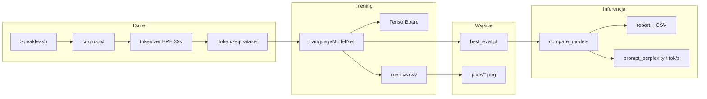
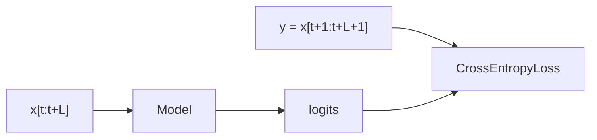
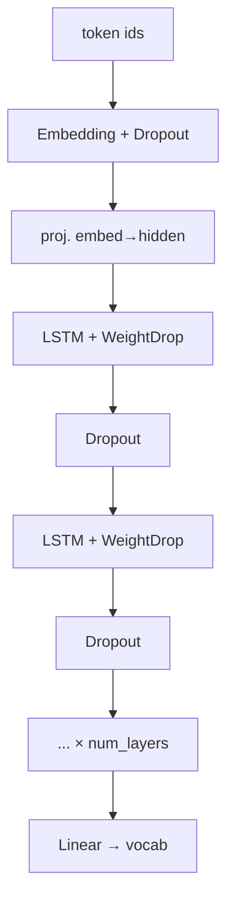
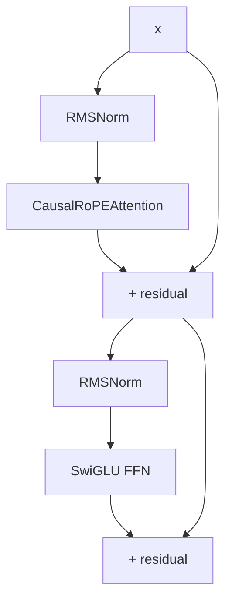
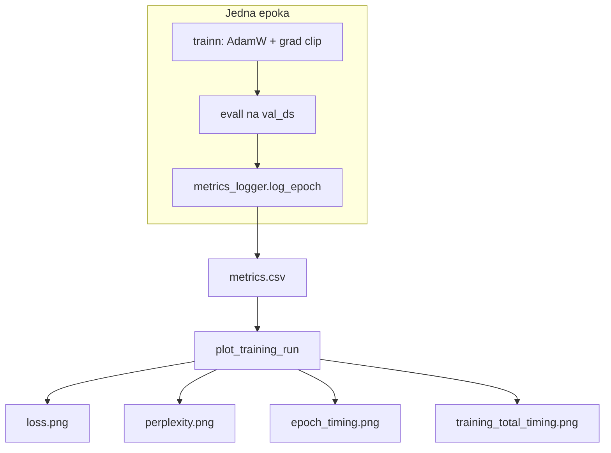
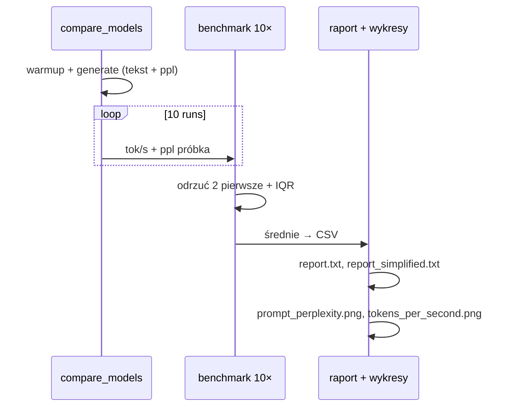

# Raport — language modeling (PL)

Materiał pod [2-language-modeling.md](2-language-modeling.md): **dwa modele** (RNN + Transformer), **perplexity**, **czas treningu i inferencji**, **≥10 promptów**, opis architektury z diagramami i odwołaniami do kodu.

**Wybrane modele do obrony:**

| Rola | `architecture` | Plik |
|------|----------------|------|
| RNN | `rnnAWDLSTM` | [`src/models/rnnAWDLSTM.py`](src/models/rnnAWDLSTM.py) |
| Transformer | `transformer_miniLLaMA` | [`src/models/transformer_miniLLaMA.py`](src/models/transformer_miniLLaMA.py) |

Presety lokalne (GTX 1660 6 GB): [`src/training_presets.py`](src/training_presets.py) — `LOCAL6G_AWD`, `LOCAL6G_LLAMA`.

---

## 1. Zadanie ↔ realizacja (skrót)

| Wymaganie | Jak realizujemy | Artefakt do raportu |
|-----------|-----------------|---------------------|
| Causal LM (next token) | `TokenSeqDataset`: `y = x` przesunięte o 1 | schemat §2 |
| Korpus PL | Speakleash `wolne_lektury_corpus` → `corpus.txt` | [`text_data.py`](src/text_and_tokenizer/text_data.py) |
| Held-out eval | split 90/10, `evall` → `eval_perplexity` | `saved_models/.../metrics.csv`, `plots/perplexity.png` |
| Czas treningu | `train_seconds`, `eval_seconds`, `train_total_seconds` | `plots/epoch_timing.png`, `run_meta.json` |
| Czas inferencji | prefill + generate, benchmark 10×, tok/s | `model_evaluations/.../inference.csv`, `tokens_per_second.png` |
| ≥10 promptów | `infer.compare_models` w [`main.py`](src/main.py) | `report_simplified.txt`, `<GEN>` |
| Architektura w raporcie | ten dokument + `model_summary.txt` | slajdy §3–4 |

---

## 2. Pipeline (cały projekt)

**Kod:** przygotowanie danych [`prepare_language_data`](src/text_and_tokenizer/text_data.py) (ok. 238–259), trening [`train.main`](src/train.py) (ok. 740+), ewaluacja [`infer.compare_models`](src/infer.py) (ok. 270+).

---

## 3. Zadanie causal language modeling

Model dostaje sekwencję tokenów \(x_1,\ldots,x_T\) i uczy się przewidywać \(x_{t+1}\) z prefiksu (bez „patrzenia w przyszłość” przy treningu w oknie; przy transformrze — maska w attention).

| Element | Kod |
|---------|-----|
| Okno treningowe | [`TokenSeqDataset.__getitem__`](src/text_and_tokenizer/text_data.py) (~224–229) |
| Loss | [`LanguageModelNet.trainn`](src/train.py) (~428–437) |
| Perplexity na walidacji | [`evall`](src/train.py) (~495+) |

---

## 4. Model RNN: `rnnAWDLSTM`

### 4.1 Schemat przepływu

### 4.2 Składniki (do raportu / slajdu)

| Element | Co robi | Gdzie w kodzie |
|---------|---------|----------------|
| **Embedding** | token id → wektor | `self.embedding` (~71+) |
| **Dropout na embed** | regularyzacja wejścia | `embed_dropout` |
| **LSTM** | stan ukryty \(h_t,c_t\), kolejność czasowa | `nn.LSTM` w pętli warstw (~78–80) |
| **WeightDrop** | w treningu losowy **DropConnect** na macierzy `weight_hh` (wiersze wag zerowane), nie to samo co **weight decay (L2)** w AdamW | [`WeightDropLSTM`](src/models/rnnAWDLSTM.py) (~14–41), docstring modułu (~1–12) |
| **Dropout między warstwami** | na aktywacjach | `inter_drop` |
| **Warstwa wyjściowa** | hidden → vocab | `self.fc`; opcjonalnie **weight tying** z embeddingiem (`maybe_tie_lm_head`) |
| **Stany w inferencji** | `init_hidden`, przenoszenie \(h,c\) krok po kroku | [`generate`](src/train.py) gałąź RNN (~651+) |

**Na prezentacji:** AWD-LSTM to odpowiedź na przeuczenie klasycznego LSTM — WeightDrop regularizuje **wagi rekurencyjne**, nie tylko aktywacje.

**Baseline z zadania:** prostsze `rnnLSTM`, `rnnGRU`, `rnnRNN` w [`src/models/`](src/models/) — bez WeightDrop.

---

## 5. Model Transformer: `transformer_miniLLaMA`

### 5.1 Schemat jednego bloku (pre-norm)

Stos: `tok_emb` → `N × Block` → `RMSNorm` → `lm_head` (wagi tied z embeddingiem) — [`transformer_miniLLaMA`](src/models/transformer_miniLLaMA.py) (~133–161).

### 5.2 Składniki (do raportu / slajdu)

| Element | Co robi | Gdzie w kodzie |
|---------|---------|----------------|
| **RMSNorm** | normalizacja przez RMS (bez odejmowania średniej); stabilny trening, tańsza od LayerNorm | klasa `RMSNorm` (~14–22), użyte w `Block` (~77–79) |
| **CausalRoPEAttention** | self-attention: Q,K,V; **maska dolnotrójkątna** (tylko przeszłość); **RoPE** na Q i K; **KV cache** przy generacji | (~37–71); maska (~66–67) |
| **RoPE** | pozycja zakodowana obrotem w przestrzeni cech Q/K | [`models/_rope.py`](src/models/_rope.py), `apply_rope` |
| **SwiGLU** | FFN: `SiLU(W1·x) ⊙ (W2·x)` → `W3`; zamiennik 2-layer MLP z ReLU | klasa `SwiGLU` (~25–34) |
| **Causal LM** | brak dostępu do przyszłych tokenów | maska w attention |
| **KV cache** | przy inferencji doklejane K/V z poprzednich kroków | `cache` w `forward` bloku (~59–62) |

**Porównanie z RNN (slajd „dlaczego Transformer”):** równoległość w treningu w obrębie sekwencji vs sekwencyjność LSTM; koszt \(O(T^2)\) vs \(O(T)\) na warstwę; u nas mały model → RNN często **szybszy w tok/s**, Transformer lepszy lub gorszy w **ppl** zależnie od budżetu treningu.

**Quiz „Attention Is All You Need”:** QKV z jednego `Linear`, skalowanie \(1/\sqrt{d_h}\), softmax, residual.

---

## 6. Trening, metryki, wykresy

| Metryka | Znaczenie | Kod / plik |
|---------|-----------|------------|
| `train_loss` / `train_perplexity` | jakość na oknach treningowych | [`trainn`](src/train.py) |
| `eval_loss` / `eval_perplexity` | **held-out** 10% tokenu | [`evall`](src/train.py) |
| `train_seconds` / `eval_seconds` | czas na epokę | [`log_epoch`](src/metrics/run_metrics.py) |
| `train_total_seconds` | wall clock całego `train.main` | `run_meta.json` |

Optymalizator: **AdamW** `lr=3e-4`, clip grad norm 1.0 — [`trainn`](src/train.py) (~399–438).

---

## 7. Inferencja i ewaluacja zadaniowa

| Element | Opis | Kod |
|---------|------|-----|
| Prompty (≥10) | lista w [`main.py`](src/main.py) `infer.compare_models` |
| Tekst w raporcie | pierwszy run; format `<GEN>` + seed + kontynuacja | [`infer_metrics.py`](src/metrics/infer_metrics.py) |
| tok/s i ppl | średnia z 10 runów | [`_generate_with_bench_tps`](src/infer.py) |
| Wykresy | linie = modele, oś X = pierwsze słowa promptu | [`plot_inference_eval`](src/metrics/plot_inference.py) |
